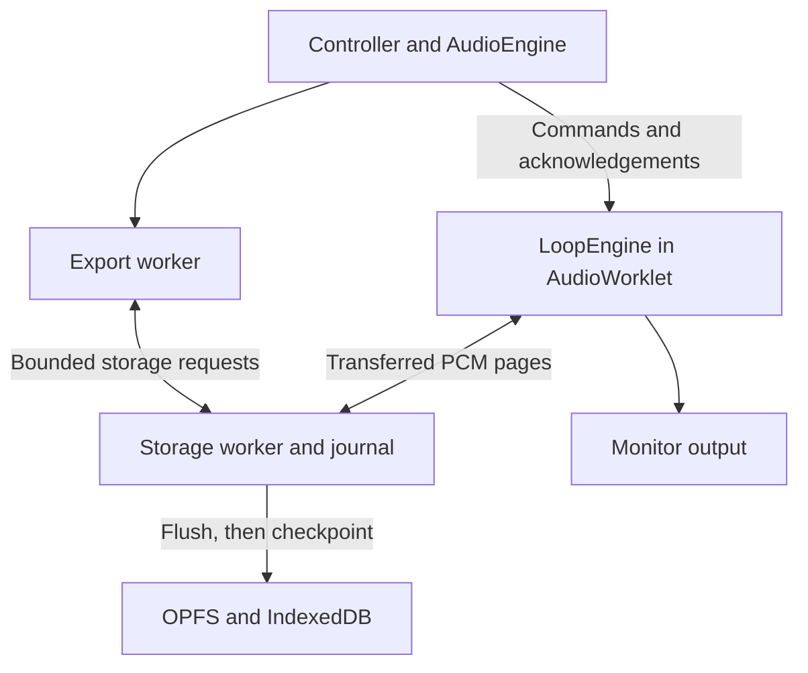

# Audio architecture

Feed the Music Loop is a static application spanning the interface, audio rendering thread, and storage/export workers. `src/audio/loop-worklet.mjs` contains `LoopEngine`, also used by Node tests and the export worker. `src/audio/client.mjs` manages browser audio and microphone lifecycle; `src/controller.mjs` coordinates project metadata and publication. Audio samples never depend on interface redraw timing.

## Clock and loop boundaries

The engine maintains two sample counters. `clock` advances for every processed sample, including stopped transport. `frame` is the musical transport position and advances while playing, except during the initial count-in. Both are ordinary safe-integer numbers; frame and page arithmetic must not use 32-bit coercions. Processing respects the actual output block length.

The first loop, free or timed, establishes `baseFrames` from its recorded musical duration. An empty project's first loop resets the musical origin to zero. Persisted `loopRecording` preferences select free length, seconds rounded to audio frames, or a whole number of base cycles. Start timing is independent: immediate is the default, and explicit next-cycle mode schedules a playing transport's next base boundary. Immediate capture begins at the first sample of the next render quantum after arming. Explicit Finish ends at the current musical frame, subject to the minimum safe duration, even for a timed loop; it does not wait for a boundary. Playback position is positive modulo of `frame - offsetFrames` by the track length. A newly recorded loop stores its start modulo its own length, preserving its entrance phase without restarting existing loops. A short playback-only edge taper reduces boundary clicks; saved PCM is unchanged.

The optional click derives every beat from the audio clock. Once a base exists, its subdivisions follow that base. The first-loop count-in holds the musical origin until recording starts. Click audio enters only the monitor path.

## Capture and compensation

Manual compensation is frozen for each capture. For offset `C`, a musical window from `S` to `E` consumes microphone samples in the corresponding clock interval `[startClock + C, endClock + C)`. The next loop repeat begins at `E`; capturing its delayed ending continues independently. The loop must contain at least `C + 129` frames so that this turnaround has usable opening audio.

Loop recordings and continuous vocals retain mono microphone PCM after input gain, before track effects. A vocal performance simultaneously writes a stereo master. Processed backing and smoothed master gain have bounded history rings; the master combines their values from `C` frames earlier with the arriving vocal before the final soft ceiling. Vocal effect changes during a compensated take are queued by the same offset. Input gain is already baked into the raw recording and must not be applied again during rendering.

Monitoring is independent of capture. Stop silences playback and monitoring immediately, freezes transport, and drains the aligned capture ending before resetting effects. Device interruption instead seals the samples already captured; it does not invent a compensating silence tail. The captured master has the exact body window and no appended effect tail. It remains the authority for the original performance.

## Publication and recovery

Before arming, the controller saves a capture intent and creates its audio assets. `capture-start` supplies the authoritative frame and mixer snapshot after any section scheduled for that boundary. Rejected arms identify their capture; partial worklet preparation is rolled back before the controller cancels those assets.

A loop starts sounding at its musical end, before storage can confirm durability. The worklet tracks this provisional loop until a complete, exact-length seal arrives. Late write failure, interrupted seal, or length mismatch removes only that provisional loop and releases its cache. If it established the empty project's base, that base is cleared appropriately. Stale project configurations carrying a zero base cannot erase the provisional grid while it awaits sealing.

The controller publishes only matching complete loop audio. Vocal publication waits for both raw and master seals; unequal or interrupted streams retain their actual lengths and a verified editable interval. Capture intents support recovery after reload. Missing arrangement events limit edited reconstruction to the acknowledged prefix without shortening the original audio files.

## Bounded storage and playback

Production pages contain 16,384 float32 frames. The client supplies 24 transferable buffers, each large enough for a stereo page. A direct worklet–storage `MessagePort` carries writes, reads, acknowledgements, and recycled buffers. The audio callback never waits for storage. If it cannot reserve both vocal and master buffers, it stops both at a valid common prefix.

The journal writes and flushes PCM before committing page metadata and acknowledging its checkpoint. OPFS is preferred, with IndexedDB fallback. The fair queue limits queued writes, reads, and bytes; checksums detect damaged pages. Finalization is distinct from a page acknowledgement.

Each playback consumer owns four pinned opening pages and twelve rolling LRU pages. Consumers sharing one asset still need independent windows because their phases can differ. Read-ahead starts before playback; readiness requires opening and current-phase pages. Missing data raises an underrun while transport keeps its timing. Cache memory grows with active consumers, not recording duration.

## Editing and rendering

Track DSP provides gain, pan, high-pass filtering, three-band EQ, and compression, with shared backing and vocal effects. Audible command acknowledgements carry their effective frame. Only continuous vocal performances retain arrangement logs; loop captures need no discarded automation history. Sections apply membership, mute, solo, and mix together at a base boundary. Undo or deletion cancels a queued section before it can reapply itself.

Undo restores metadata and reconciles every track with the worklet, including changes previously sent directly. Same-asset updates preserve DSP and cache state. Completed recorded loops are adopted into the client registry without restarting their already-playing audio. History excludes live capture intents and bounds retained snapshot metadata.

Export builds an immutable plan and runs the same engine in a worker. It preserves event order, splitting processing at exact event frames, and bounds concurrent source reads. Current mode combines today's sound settings with recorded arrangement changes; performance mode replays recorded sound controls. Default warm-up is five seconds, followed by the exact body and an optional two-second effect tail. Warm-up cannot recreate unrecorded microphone history, so a render is not guaranteed to reproduce the captured master sample-for-sample.

## Contributor invariants and practical limits

Preserve sample-clock boundaries, independent loop phase, paired capture prefixes, flush-before-acknowledgement ordering, provisional-loop invalidation, and capture-ID correlation. Never silently reinterpret damaged audio as a different loop duration. Preserve original assets when export or publication fails.

Recording has no short duration timer; storage, processing capacity, browser behavior, and arrangement metadata remain practical limits. The 512-track format ceiling is not a device performance guarantee. Edited renders allow up to 24 hours per operation. Import and fallback export have separate memory-related limits documented in the README. Metadata budgets constrain arrangement complexity rather than elapsed audio time.
